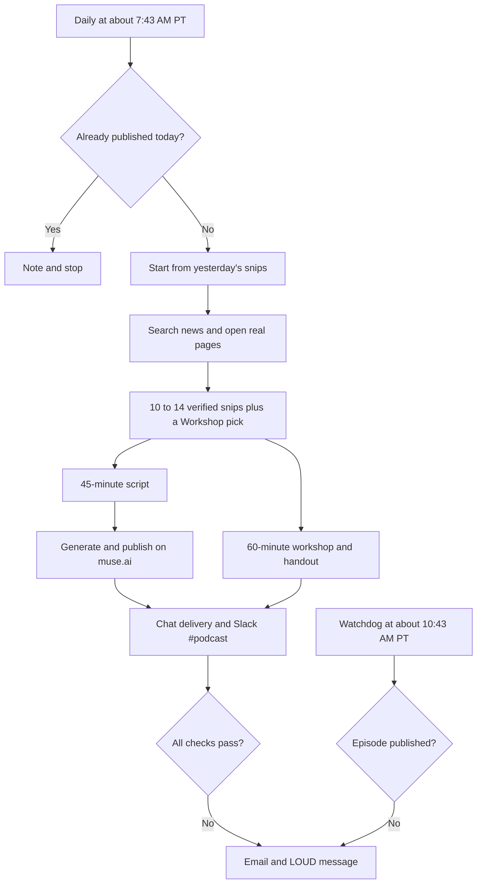

# Soft Fork

Soft Fork is my daily AI podcast. Two hosts, Maya and Theo, spend about 45 minutes on what's trending in AI tools, gossip first and tech second. It was called "AI Tools Daily" until it was renamed on October 6, 2026.

This repo shows how the agent behind it finds the news, chooses what goes in and turns it into an episode and a workshop. The exact prompts are in [prompts/muse-soft-fork-prompts.md](prompts/muse-soft-fork-prompts.md).

## The basics

- **Where it's hosted:** an AI agent called Muse runs it as a scheduled cloud job. It doesn't need my Mac to be on.
- **Cadence:** the main job (`ai-tools-daily`) runs daily at about 7:43 AM PT. A watchdog job (`ai-tools-daily-watchdog`) runs at about 10:43 AM PT to make sure the episode went out. An Instagram job is saved but has been turned off since October 15, 2026.
- **What it reads:** yesterday's snips file, recent episode topics from the podcast manifest and the web through browser search and real pages and videos.
- **What it writes and where:** a daily snips file, a 45-minute episode on the Soft Fork feed on muse.ai (it also shows up in Apple Podcasts), a transcript, a 60-minute workshop with a handout, a message in Muse's main chat and two posts in the #podcast channel of the La Maison Slack workspace. The posts are the episode links and a short video highlight.
- **Why it matters:** it keeps me current on AI tools every day and turns the best story into a hands-on workshop for small business owners.
- **Where runs are logged:** each run writes notes to Muse's daily memory log (`~/memory/YYYY-MM-DD.md`). The dated snips file and the podcast manifest also show what ran. If anything fails, I get an email and the chat message starts with "LOUD".

## How the agent searches

1. **Duplicate check first.** If today's episode is already in the manifest, it posts a one-line note and stops.
2. **Start from yesterday.** It opens yesterday's snips file, keeps its source list and format and only looks for what is new or changed.
3. **Focus.** It looks for what people are talking about and demonstrating in AI consumer tools today: automations, agent loops, skills, plugins and end-to-end workflows. One-off prompt tricks are out. It keeps an eye on Grok Bot, ChatGPT, Codex, Claude Code and Gemini.
4. **Must-check sources.** These are Claire Vo's "How I AI", Lenny's Podcast and Lenny's Newsletter, Airtable's "Built on Air" podcast and demo videos people share on YouTube, X and TikTok.
5. **How it searches.** It uses browser search on the news vertical for recency and opens real pages and videos. It prefers items from the last 7 days.
6. **No making things up.** It never invents episodes, links or tool features. It only reports what it confirmed on a real page.

## How it chooses what goes in

- **Snips:** it saves 10 to 14 snips. Each one has the source, the title, the date, the link and a 3 to 5 sentence summary. The summary says what the tool does, what the demo showed, the real use case and whether it's a loop, workflow or plugin or just a one-off.
- **Fresh topics:** before writing, it reads recent episodes' topics and steers away from repeats.
- **Episode slots:** the biggest story gets Deep dive 1 (12 to 15 minutes). The second biggest gets Deep dive 2 (10 to 12 minutes). The rest go in a rapid-fire roundup at about a minute each. The cold open riffs on the day's wildest or funniest item.
- **Workshop pick:** the one snip with the richest end-to-end workflow and the best fit for small business owners. It becomes a 60-minute workshop with a plain name that says what it teaches.
- **Video highlight:** the best teaching moment from the episode, the thing a listener would miss out on, not just the flashiest news.

## How the episode is made

- **Script:** about 7,500 to 8,000 words of spoken dialogue with no links, markup or stage directions.
- **Tone:** loose and funny with jargon explained in one plain sentence. Laughs are written into the lines and build up slowly, with 2 to 4 real shared laughs per episode.
- **Audio:** `podcast-helper generate` makes the audio with fixed voices and a fixed pixel-art giraffe cover. Then `podcast-helper publish` puts it on the Soft Fork feed. The generated audio is the episode.
- **Failed audio:** if it fails, the job retries with the same voices on a growing delay and never ships a partial episode.

## Workflow

More detail is in [docs/workflow.md](docs/workflow.md).

## What's in this repo

- `prompts/muse-soft-fork-prompts.md`: Muse's saved prompts for all three jobs, as Muse exported them on November 3, 2026, with private details removed.
- `docs/workflow.md`: the full flowchart.
- `examples/snips/`: 17 real daily snips files from October 1 to 23, 2026.
- `examples/EPISODE-example.md`: how a workshop repo points back to its episode.

## Still unknown

- The podcast-helper and remote-storage tools belong to Muse. How they work inside isn't shown here.
- The daily memory log lives inside Muse, so I can't link to it.
