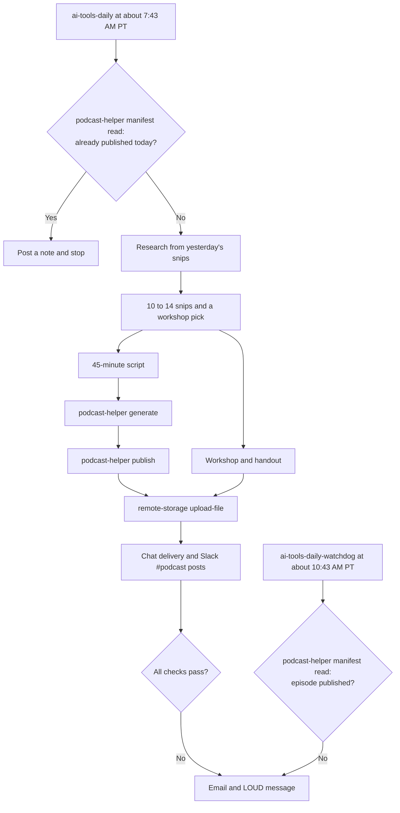

<p align="center"></p>

<h1 align="center">Soft Fork</h1>

<p align="center"><b>Subscribe:</b> paste this RSS feed into any podcast app that accepts a feed link, such as Apple Podcasts, Overcast, or Pocket Casts.</p>

```
https://muse.ai/podcasts/feed/1195108097011732/642ffc17-909b-4c25-a2ce-323d47246b4e
```

Soft Fork is my daily AI podcast. Two AI hosts, Maya and Theo, talk for about 45 minutes about what's trending in AI tools. Gossip comes first and tech comes second. The show was called "AI Tools Daily" until October 6, 2026.

An AI agent called Muse makes every episode. Muse's exact prompts are in [prompts/muse-soft-fork-prompts.md](prompts/muse-soft-fork-prompts.md).

## How it runs

- **Host:** Muse runs Soft Fork as a scheduled cloud job. My computer doesn't need to be on.
- **Schedule:** The main job, `ai-tools-daily`, runs every day at about 7:43 AM PT. The watchdog job, `ai-tools-daily-watchdog`, runs at about 10:43 AM PT. A saved Instagram job has been turned off since October 15, 2026.
- **Inputs:** The job reads yesterday's research file, recent episode topics from the catalog, and real web pages and videos.
- **Outputs:** Each run writes the items below.
  - A research file of 10 to 14 short summaries. Muse calls each summary a snip.
  - A 45-minute episode on the Soft Fork feed.
  - A word-for-word transcript.
  - A 60-minute workshop plan and a printable handout.
  - A message in Muse's main chat.
  - Two posts in the #podcast channel of the La Maison Slack workspace. The first post has the episode, transcript, workshop, and handout links. The second post has a short video highlight.
- **Logs:** Each run writes notes to Muse's daily memory log at `~/memory/YYYY-MM-DD.md`. The catalog also records every episode.
- **Failure alerts:** If any check fails, Muse emails me. The chat message then starts with "LOUD".

## How the agent searches

1. Muse runs `podcast-helper manifest read`. It stops if today's episode is already in the catalog.
2. Muse opens yesterday's research file and keeps its source list. It looks only for news that is new or changed.
3. Muse looks for automations, agent loops, skills, plugins, and end-to-end workflows in AI consumer tools. It skips one-off prompt tricks.
4. Muse follows Grok Bot, ChatGPT, Codex, Claude Code, and Gemini.
5. Muse always checks "How I AI" with Claire Vo, Lenny's Podcast and Lenny's Newsletter, Airtable's "Built on Air" podcast, and demo videos shared on YouTube, X, and TikTok.
6. Muse searches news results and opens the real pages and videos. It prefers items from the last 7 days.
7. Muse reports only what it confirmed on a real page. It never invents episodes, links, or tool features.

## How it chooses what goes in

- **Snips:** Each snip lists the source, title, date, and link. Its summary says what the tool does and what the demo showed. The summary also says whether the item is a reusable workflow or a one-off.
- **Repeats:** Muse reads the topics of recent episodes and picks fresh material.
- **Cold open:** The hosts riff on the day's wildest or funniest item for 2 to 3 minutes.
- **Deep dives:** The biggest story gets 12 to 15 minutes. The second biggest story gets 10 to 12 minutes.
- **Roundup:** The remaining snips get about one minute each.
- **Workshop pick:** The snip with the richest end-to-end workflow for small business owners becomes the day's workshop. The workshop name must say what it teaches.
- **Video highlight:** Muse picks the episode's best teaching moment for the video. It avoids picking the flashiest news.

## How the episode is made

- **Script:** Muse writes about 7,500 to 8,000 words of spoken dialogue. The script has no links, markup, or stage directions.
- **Tone:** The hosts explain each needed technical term in one plain sentence. Laughs are written into the lines. Each episode has 2 to 4 big shared laughs.
- **Audio:** `podcast-helper generate` makes the audio with fixed voices and the `soft-fork-v1` series cover.
- **Publishing:** `podcast-helper publish --slug <slug> --feed-title "Soft Fork"` puts the episode on the feed. A blocked publish counts as a failure and is never retried.
- **Voice failures:** Muse retries after about 5 minutes, 10 minutes, 30 minutes, and 1 hour. It never ships a partial episode.
- **Slack links:** `remote-storage upload-file` gives the transcript, workshop, handout, and video public links. The links expire after 48 hours or less.

## How I taught Muse to be funny

When I started Soft Fork, the hosts told jokes but never laughed. It sounded strange and flat. I noticed it and decided to fix it.

I tested two ways to make the hosts laugh. In the first test, the laughs were written into the script as words, like "Ha ha ha." In the second test, I used stage directions, like [laughs]. The stage directions did nothing at all. The voices skipped right over them and there was no laughing in the audio. The written laughs worked.

Written laughs alone were not enough. The voices sounded too monotone, and the laughs did not overlap the way real people laugh. So I built the next version line by line, with one host starting to laugh and the other host joining in, and a groan when a joke was corny. That was better, but the big shared laugh came too fast and felt fake.

So I slowed it down. The final version starts straight, then a small "Heh," then one host chuckling alone, then a groan at the corny joke, and only later one big shared laugh that lasts and trails off. That version sounded real. It made me smile when I listened to it.

Those rules are now written into the podcast's daily instructions: laughs are written as words, stage directions are banned, laughter builds up gradually, corny jokes get a groan, and there are two to four shared laughs in each episode.

Now the hosts laugh like real co-hosts, and the podcast is genuinely funny.

## Workflow



[docs/workflow.md](docs/workflow.md) has the full flowchart. [docs/tools.md](docs/tools.md) explains both command line tools.

## Repo contents

- `prompts/muse-soft-fork-prompts.md`: Muse's prompts for all three jobs, with private details removed.
- `docs/workflow.md`: the full flowchart.
- `docs/tools.md`: the reference for `podcast-helper` and `remote-storage`.
- `tools/podcast_telemetry.py`: the helper file that `podcast-helper` loads.
- `examples/snips/`: 17 daily research files from October 1 to 23, 2026.
- `examples/EPISODE-example.md`: how a workshop repo links back to its episode.
- `assets/cover.jpg`: the cover image from the RSS feed.

## License

All rights reserved. You may view this repo on GitHub, but you may not copy, modify, or share it without my written permission. See [LICENSE](LICENSE).

## Not included

- The `podcast-helper` script is not in this repo yet.
- `remote-storage` is a compiled program with no readable source.
- Muse's daily memory log is inside Muse and can't be linked.
