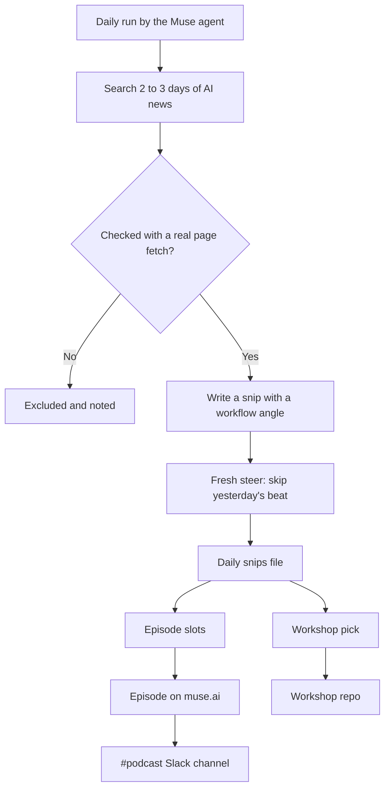

# Soft Fork

Soft Fork is my daily AI podcast about new AI tools and what they mean for real workflows. Early episodes went out as "AI Tools Daily" (October 1 to 5, 2026). From October 6, 2026 they are titled "Soft Fork".

This repo explains how the agent behind it finds the news and chooses what goes into each episode.

## The five basics

- **Where it's hosted:** an AI agent called Muse makes the research and episodes. Episodes are published on a muse.ai podcast feed. Where Muse itself runs and on what schedule is not visible from the files I have, so treat that as unknown.
- **What it reads:** AI and automation news from the last two to three days. Sources seen in past runs include TechCrunch, VentureBeat, Business Wire, LinkedIn posts, YouTube creator videos, newsletters such as How I AI and podcasts.
- **What it writes and where:** one daily research file of "snips" (see `examples/snips/`), the episode audio on muse.ai and posts in the #podcast Slack channel with episodes and short video highlights. Each day's workshop pick also became an Automate Your Business workshop repo.
- **Why it matters:** it keeps me current on AI tools in about one episode a day and turns the best story into a hands-on workshop for small business owners.
- **Where runs are logged:** each run leaves a dated snips file. There is no separate run log that I could find.

## How the agent searches

Based on the snips files, each run:

1. Looks at a short window, usually the last two to three days.
2. Checks every item with a real page fetch or search result. Each snip records the source, the date and the link.
3. Drops anything it can't confirm and says why. One example: a payments story was excluded because its launch date turned out to be wrong.
4. Reads the previous day's batch first and writes a "fresh steer" so it follows the next beat instead of repeating itself.
5. Can stage a story the night before as a candidate for the next episode.

## How it chooses what goes in

Each snip gets a "Loop/workflow angle" that answers one question: what does this change for someone building workflows or advising clients? Stories with a clear angle make the cut. Stories with caveats stay in, but the caveats are spelled out, for example "vendor numbers, unaudited" or "company claim, not verified".

Snips are then sorted into episode slots:

- **Deep dive:** the biggest story with the most practical workflow angle.
- **Rapid fire or roundup:** short items and follow-ups to earlier coverage.
- **Cold open:** light or viral items.

The **workshop pick** is the one snip with the richest end-to-end workflow that a small business owner can use right away. It should also continue the arc of earlier workshops.

## Workflow

More detail is in [docs/workflow.md](docs/workflow.md).

## What's in this repo

- `examples/snips/`: 17 real daily research files from October 1 to 23, 2026.
- `examples/EPISODE-example.md`: how a workshop repo points back to its episode.
- `prompts/`: Muse's actual instructions belong here. I don't have a copy yet.

## Gaps

- Muse's prompt or script is not in this repo yet. Everything above is worked out from its output.
- How the audio is made and the exact daily schedule are unknown.
