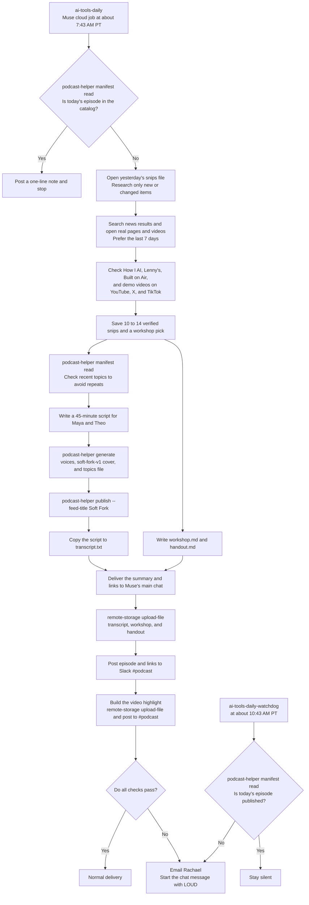

# Soft Fork workflow

This chart follows Muse's prompts in [prompts/muse-soft-fork-prompts.md](../prompts/muse-soft-fork-prompts.md). [tools.md](tools.md) explains each command.

The saved Instagram job has been turned off since October 15, 2026, so the chart leaves it out.
