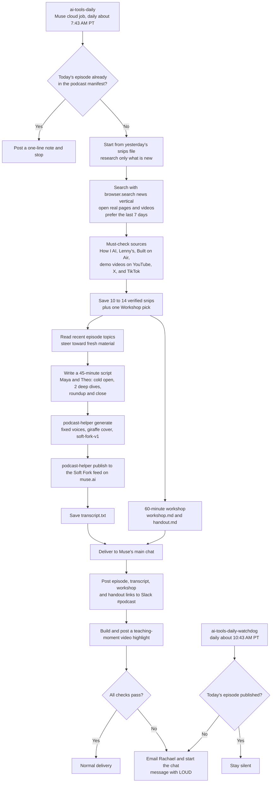

# Soft Fork workflow

This follows Muse's saved prompts in [prompts/muse-soft-fork-prompts.md](../prompts/muse-soft-fork-prompts.md).

A third job, ai-tools-daily-instagram, is saved but has been disabled since October 15, 2026, so it is left out of the chart.
